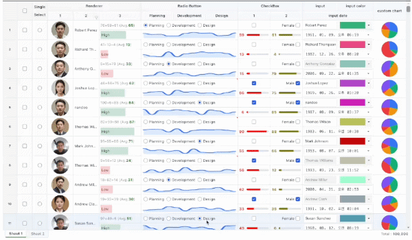

# Ninelab HTML Table (`@ninebone/datagrid`)

> **Blazing-fast performance powered by native HTML tags** — A next-generation table extension supporting 1,000,000+ rows virtual rendering and seamless inline editing out of the box.

[](https://opensource.org/licenses/MIT)
[](https://www.npmjs.com/)

Tired of heavy, overly complex JavaScript data grids? **Ninelab HTML Table** preserves the familiar structure of native HTML tags while leveraging advanced DOM virtualization to handle massive datasets effortlessly and provide a frictionless inline editing experience.

---

## Key Features

- **1M+ DOM Virtualized Rendering:** Scroll and render over a million rows in a fraction of a second without dropping frames.
- **Seamless Inline Editing & Form Binding:** Native support for Text, Number, Date, Color, Checkbox, Radio, and Combo (Autocomplete) input types.
- **HTML Tag-Based (Zero Learning Curve):** No complicated JS configuration objects required—build tables using familiar tag structures.
- **Shadow DOM & CSS Variables:** Perfect style encapsulation with zero CSS pollution, easily customizable via CSS variables.
- **Framework Agnostic:** Drops seamlessly into React, Vue, Svelte, or Vanilla JS.

---

## Live Demo & Previews



- [Live Demo](https://ninebone.github.io/datagrid/)

---

## Quick Start

### 1. Installation

```bash
npm install @ninebone/datagrid
```


### 2. HTML example

```html
    &lt;ninelab-table show-footer="true">
        &lt;table row-indicator="true">
            &lt;tbody>
                &lt;tr>
                &lt;td data-bind="sel" cell-type="checkbox">&lt;/td>
                &lt;td data-bind="NAME" data-expr="host.renderImage(data.PIC)" html="true">&lt;/td>
                &lt;td data-expr="host.renderBadge(data.REC1, data.REC2)" html="true">&lt;/td>
                &lt;td data-bind="NAME" cell-type="input" enable="data.REC1 > 30">&lt;/td>
                &lt;/tr>
            &lt;/tbody>
        &lt;/table>
    &lt;/ninelab-table>


    &lt;script>
        const grd = document.querySelector("nine-table");

        grd.provider.add({
            getCommonCode: (group) => exampleData.generateCommonCode(group),
            renderImage: (v) => ``,
            renderBadge: (v1, v2) => `<span>Score: ${Number(v1) + Number(v2)}</span>`,
        });
			
        grd.addEventListener("load", () => {
            // Binding Data
            grd.data.set([
              {
              },
              ...
            ]);
        });
    &lt;/script>
```


## LICENSE
MIT © 2026 ninebone
